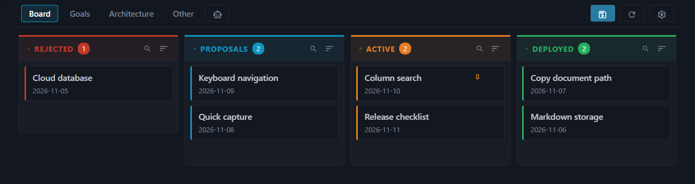

<div align="center">

# Kanban VSC

**Your tasks. Your Markdown. Your editor.**

A local Kanban board for VS Code, powered by the files in your project.
No account, database or cloud service required.

[Get started](#get-started) · [Try the demo](#try-the-demo) · [How it works](#how-it-works) · [Development](#development)

</div>



## Keep work close to your code

Turn a `docs/` folder into a board you can browse, search and update without leaving VS Code. Each task remains an ordinary Markdown file you can edit, review and version with Git.

| Organize your work | Make it your own |
| --- | --- |
| **Drag and drop** cards between statuses and reorder columns. | **Column search** filters by title or relative file path. |
| **Pin important tasks** and sort each column independently. | **Visibility controls** show or hide header tabs and actions. |
| **Track goals** with sections and checkbox lists. | **Polish and English** interfaces with adjustable UI scale. |
| **Keep design notes** in Architecture and general documents in Other. | **Compact sidebar** gives quick access to tasks and goals. |

Open Markdown previews directly from cards, copy document paths, and use **Save** to create a local Git commit of your docs changes.

## Get started

1. **Install the extension.** Download the `.vsix` file from the [latest release](https://github.com/Veizeczek/kanban-vsc/releases/latest). In VS Code, open Extensions, choose **… → Install from VSIX…** and select it. To build the package yourself, see [Development](#development).
2. **Open your project folder** and grant Workspace Trust if you trust its contents.
3. Run **Kanban: Open Kanban Board** from the command palette. You can also use the Kanban activity-bar icon or status-bar entry.
4. Open the board's **Settings** and enable the project. If `docs/` is missing, initialization creates the status folders, `goals.md` and a starter `AGENTS.md`. Existing files are preserved.
5. Use **+** in a column to create your first task, or add Markdown files to its folder.

> The extension reads `docs/` in the **first workspace folder**. Open the folder containing `docs/`, rather than `docs/` itself. An existing docs directory is used as-is.

## Try the demo

The [demo workspace](examples/demo-workspace/README.md) includes tasks in every column, a pinned card, goals, an architecture decision and a general document.

Open **`examples/demo-workspace` as a separate VS Code folder**, then run **Kanban: Open Kanban Board**. Opening the repository root or `examples/` will not show the demo tasks.

Try searching for `search` in Active, moving **Quick capture** into Active, and exploring the Goals and Architecture tabs. Use a copy of the demo folder if you want to experiment without changing the examples.

## How it works

The filesystem is the source of truth. A document's folder determines its column; moving a card moves its Markdown file and updates the `status` field.

```text
your-project/
└── docs/
    ├── proposed/       → Proposals
    ├── active/         → Active
    ├── closed/         → Deployed
    ├── rejected/       → Rejected
    ├── architecture/   → Architecture tab
    ├── goals.md        → Goals tab
    └── notes.md        → Other tab
```

Status folders are scanned recursively. Other lists files directly inside `docs/`, excluding `goals.md`. Hidden entries and symlinks are skipped.

**Refresh only reads files.** It does not rename, move or rewrite documents. Editing a title or status in frontmatter does not automatically change the filename or folder.

<details>
<summary><strong>Example task document</strong></summary>

```markdown
---
title: Add keyboard navigation
date: 2026-11-11
status: proposed
---

## brief

Navigate the board without a mouse.

## progress

- [ ] Define focus order
- [ ] Test keyboard actions

## description

Keep the focused control visible.
```

Documents without a frontmatter title use the filename. Creating a task through the UI currently accepts ASCII letters, numbers, spaces, hyphens and underscores; existing documents can have Unicode titles.

</details>

<details>
<summary><strong>Example goals document</strong></summary>

```markdown
## First release

- [ ] Review keyboard navigation
- [ ] Test light and dark themes
- [x] Prepare sample tasks

## Quality

- [ ] Keep documentation up to date
```

The Goals editor supports `##` sections and plain checkbox lists. Explicit edits normalize formatting and place completed items last. Keep complex Markdown, nested checklists and fenced examples in a separate document.

</details>

## Customize the board

In **Settings → Visibility**, choose which header elements to show: Goals, Architecture, Other, Agents, Save and Refresh. You can also toggle the copy-path icons on cards. Board and Settings remain accessible.

Header visibility is saved per workspace. Language and interface scale are available in the Interface section.

To search a column, click its magnifying glass. The search field replaces the heading; **Escape** clears the filter and restores it. Filters stay in place when the board refreshes.

## Your files stay under your control

- **Read-only browsing:** opening, refreshing, searching and sorting do not write document contents.
- **Explicit changes:** creating, moving, pinning and editing goals modify the corresponding files. Unsaved changes in the same document block these operations.
- **Deletion through trash:** the extension requests VS Code's trash operation instead of permanently deleting a document.
- **Local Git saves:** Save stages and commits `docs/`, respects `.gitignore`, and does not push or include unrelated staged changes.

Git hooks and filters may run during Save, so use trusted repositories and review documents before committing them.

Only local filesystem workspaces are supported. See the [security review](SECURITY.md) for protections, testing scope and remaining limitations.

## Development

```bash
npm ci
npm test
npm run compile
```

Press **F5** to launch an Extension Development Host. The `install.sh` and `install.bat` scripts are development conveniences that link this checkout into VS Code.

To inspect and build a distributable package:

```bash
npx @vscode/vsce ls
npx @vscode/vsce package
```

The VSIX contains only compiled JavaScript, media assets, the manifest, the license and the README/security documentation. See the [official packaging guide](https://code.visualstudio.com/api/working-with-extensions/publishing-extension) for distribution options.

## License and credits

The extension is [MIT licensed](LICENSE).

- [Pico CSS](https://picocss.com) — UI styles, [MIT license](media/pico-LICENSE.md).
- [Google Material Symbols](https://github.com/google/material-design-icons) — bundled icons, [Apache 2.0 license](media/icons/LICENSE).

Icons and styles are bundled locally; the extension does not fetch them at runtime.

## AI disclosure

Generative AI tools, including ChatGPT and Claude, were used during the development of this project and its documentation.
